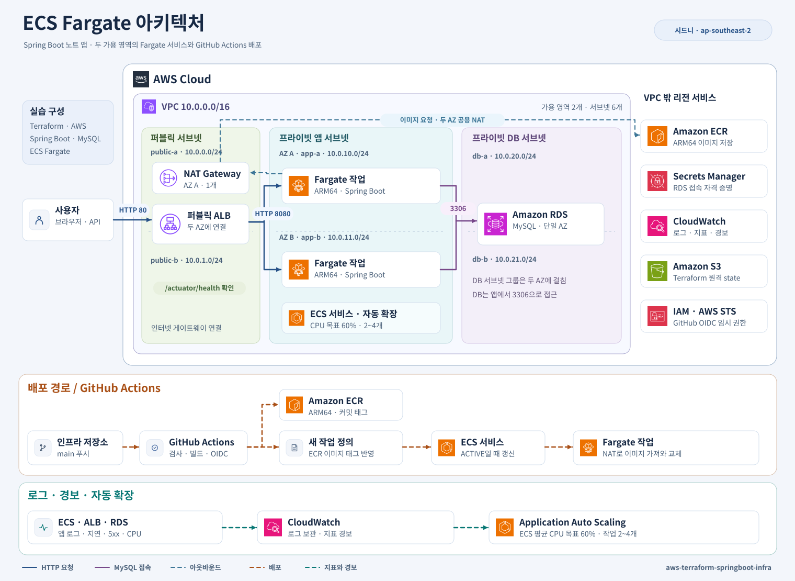
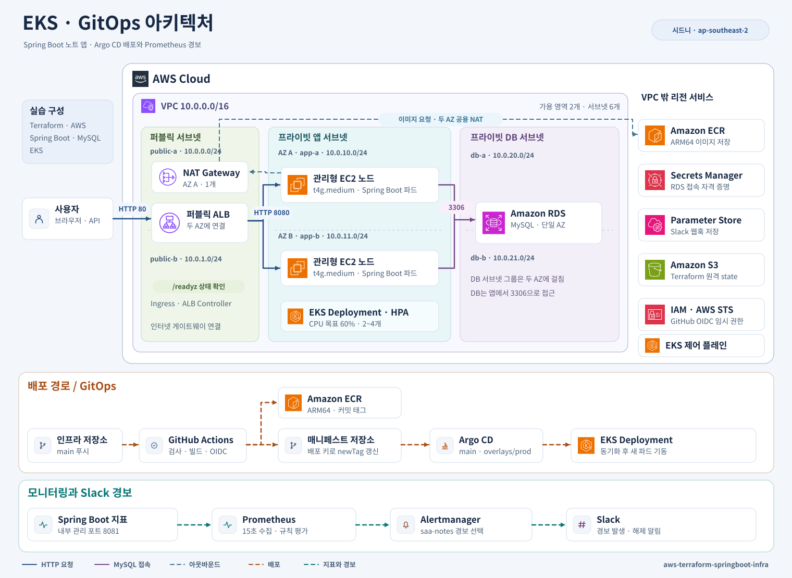

# AWS Terraform Spring Boot Infra

Terraform으로 시드니 AWS 인프라를 구축하고, 같은 Spring Boot 노트 API를 **ECS Fargate와 EKS**에 각각 배포했습니다. ECS는 GitHub Actions로, EKS는 Argo CD로 배포하며 두 환경 모두 프라이빗 RDS MySQL을 사용합니다.

## 실측 결과

| ECS 검증 | 결과 |
| --- | --- |
| 롤링 배포 중 API 요청 | **186건 모두 HTTP 200** |
| DB를 사용하지 않는 경로에 10분간 부하 | **435,969건 성공 · 실패 0건** |
| CPU 부하에 따른 자동 확장 | **작업 2개 → 4개**, 부하 종료 후 2개로 복귀 |
| 작업 한 개를 중지하는 동안 헬스 체크 | **130건 모두 HTTP 200** |

EKS에서는 파드 교체 중 요청 40건이 실패했습니다. 종료 전 15초를 기다리는 `preStop`을 적용했고, 이후 되돌리기 검증에서는 요청 실패가 0건이었습니다. [ECS 배포 기록](docs/07-cicd.md#켜진-ecs에-자동-배포-2026-11-18), [ECS 부하 실측](docs/08-ha-observability.md), [EKS 검증](docs/10-gitops-monitoring.md#gitops-배포-되돌리기-prestop-비교), [남은 과제](docs/retrospective.md#남은-과제)

## 아키텍처

그림을 누르면 원본 크기로 볼 수 있습니다.

### ECS Fargate

[](docs/diagrams/ecs-fargate.svg)

ECS에서 사용자 요청은 퍼블릭 로드 밸런서를 거쳐 Fargate 작업과 RDS MySQL로 이어집니다. GitHub Actions가 실행 중인 ECS 서비스를 갱신합니다. [ECS 아키텍처 상세](docs/ecs-architecture.md)

### EKS·GitOps

[](docs/diagrams/eks-gitops.svg)

EKS에서는 Argo CD가 매니페스트 저장소의 변경을 배포하고, Prometheus와 Alertmanager가 앱 지표를 바탕으로 Slack에 경보를 보냅니다. [EKS·GitOps 아키텍처 상세](docs/eks-gitops-architecture.md)

## 기술 스택
| 분류 | 사용 기술 |
|---|---|
| IaC | Terraform |
| Cloud | AWS (VPC, ECS, EKS, ECR, ALB, RDS, CloudWatch, IAM) |
| App | Spring Boot, Docker |
| CI/CD | GitHub Actions |

## 진행 단계
- [x] 1단계: 프로젝트 세팅, Terraform 기본 구성
- [x] 2단계: 네트워크(VPC, 서브넷 6개, 인터넷 게이트웨이, 퍼블릭 라우팅, 보안 그룹 3개)
- [x] 3단계: Spring Boot 앱 Docker화, ECR 업로드 ([문서](docs/03-app-docker.md))
- [x] 4단계: ECS Fargate + ALB 배포 ([문서](docs/04-ecs-alb.md))
- [x] 5단계: Terraform 다지기 (S3 원격 state와 잠금, 루트 분리, 모듈) ([문서](docs/05-remote-state.md))
- [x] 6단계: 데이터 계층 (RDS MySQL, Secrets Manager) ([문서](docs/06-rds.md))
- [x] 7단계: GitHub Actions CI/CD ([문서](docs/07-cicd.md)). main 푸시부터 ECS 무중단 배포까지 자동, AWS 접근은 장기 키 없이 OIDC
- [x] 8단계: [고가용성과 관측](docs/08-ha-observability.md) (멀티 AZ, CPU 자동 확장 2~4개 실측, CloudWatch 경보)
- [x] 9단계: [EKS 전환](docs/09-eks.md) (ARM64 노드 2대, ALB를 통한 RDS 저장 검증)
- [x] 10단계: [GitOps와 모니터링](docs/10-gitops-monitoring.md) (Argo CD와 별도 매니페스트 레포, Prometheus 골든 시그널 경보 -> Slack, preStop으로 배포 중 실패 40건 -> 0건)
- [ ] 마무리: 삭제 순서 문서화, 아키텍처 그림, 회고

자세한 계획과 순서를 정한 이유는 [로드맵](docs/roadmap.md)에 있습니다.

## 폴더 구조
```
bootstrap/          # Terraform state를 보관할 S3 버킷 (최초 1회)
terraform/network/  # VPC, 서브넷, 보안 그룹 (전부 무료, 항상 유지)
terraform/registry/ # ECR, GitHub Actions OIDC 배포 역할 (무료, 항상 유지)
terraform/data/     # RDS MySQL, 암호는 Secrets Manager (요금 발생, 쓸 때만 켜기)
terraform/app/      # NAT, ALB, ECS (요금 발생, 쓸 때만 켜기)
terraform/eks/      # EKS, ARM64 노드, NAT (요금 발생, 쓸 때만 켜기)
k8s/                # EKS 앱 매니페스트와 배포·정리 스크립트
app/                # Spring Boot 애플리케이션
docs/        # 설계 문서, 개발 일지, 트러블슈팅 기록
.github/     # GitHub Actions 워크플로 (CI: 테스트, 빌드, Terraform 검사 / CD: ECR 푸시, ECS 배포)
```

## 비용과 삭제 확인

NAT Gateway와 RDS는 실습에 필요한 동안만 켭니다. 시드니에서 ECS 작업 2개와 RDS·NAT·ALB를 730시간 유지하면 기본 구성은 **월 약 $111**로 추산됩니다. 삭제 뒤에는 AWS CLI로 서비스별 잔여 리소스를 확인하고, 별도 프로젝트 `aws-lab-audit`로 태그가 지정된 EBS와 Elastic IP를 조회합니다. [요금·가정과 실습 기록](docs/cost.md), [삭제 후 확인 절차](docs/teardown.md), [aws-lab-audit](https://github.com/yeopjoonhyun/aws-lab-audit)

## 공개 이력 보안 점검

인프라·매니페스트·감사 도구 저장소에서 공개 Git 참조로 접근할 수 있는 전체 이력을 검사했습니다. Gitleaks 탐지 0건이며, 실제 개인 AWS 계정 번호와 Terraform state·tfvars·환경 파일도 발견되지 않았습니다. [점검 범위와 결과](docs/devlog.md#공개-이력-보안-점검)
