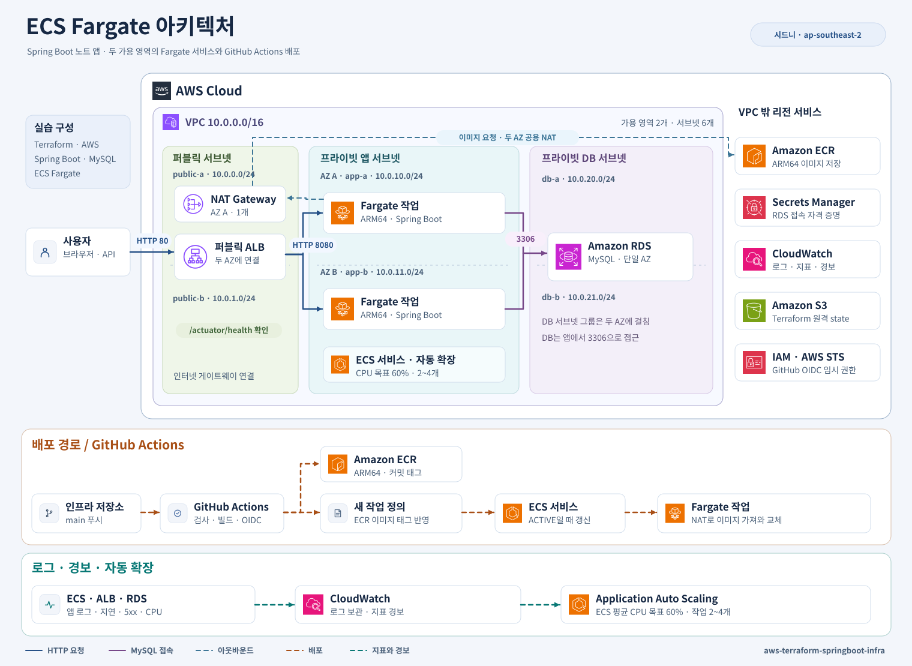

# ECS Fargate 아키텍처

시드니 리전(`ap-southeast-2`)에서 실행한 Spring Boot 노트 앱 구성이다. AZ는 리전 안에서 장애를 분리하는 가용 영역이다.

그림을 누르면 확대해서 볼 수 있다. [AWS 공식 아키텍처 아이콘](https://aws.amazon.com/architecture/icons/)

## 사용자 요청 경로

- ALB(Application Load Balancer)는 `/actuator/health`가 200을 반환하는 작업으로 요청을 보낸다. Fargate 작업은 공인 IP 없이 ARM64 컨테이너를 실행한다. ECS는 작업 2개로 시작하고, 평균 CPU 사용률 60%를 목표로 2~4개 사이에서 확장하거나 축소한다. [고가용성 실측](08-ha-observability.md)
- RDS 서브넷 그룹은 두 AZ에 걸쳐 있지만 DB 인스턴스는 한 AZ에 있다. 앱이 AWS 서비스에 접속할 때 쓰는 NAT Gateway도 비용을 줄이기 위해 AZ A에 한 개만 둔다. [네트워크 구성](02-network-design.md), [RDS 설정](06-rds.md)

## GitHub Actions 배포 경로

작업 시작 시 ECS는 실행 역할로 Secrets Manager의 DB 접속 정보를 읽어 컨테이너에 전달한다. 앱 로그는 CloudWatch Logs로 보낸다. ECS 서비스가 꺼져 있어도 이미지 업로드는 진행하고 ECS 갱신은 건너뛴다. [CI/CD 구현](07-cicd.md), [워크플로](../.github/workflows/ci.yml)
