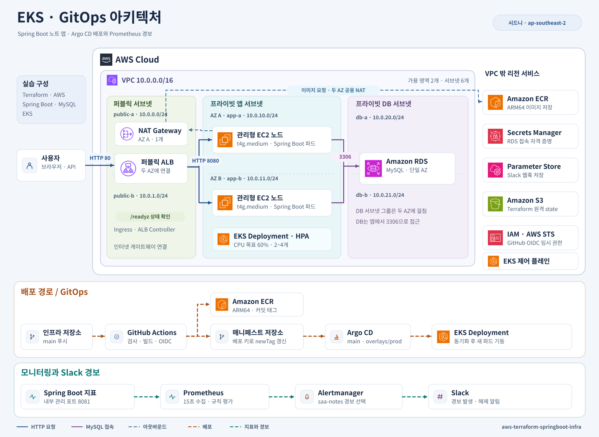

# EKS·GitOps 아키텍처

시드니 리전에서 검증한 Spring Boot 노트 앱 구성이다. GitOps는 Git에 기록한 배포 상태를 Argo CD가 클러스터에 맞추는 방식이다.

그림을 누르면 확대해서 볼 수 있다. [AWS 공식 아키텍처 아이콘](https://aws.amazon.com/architecture/icons/)

## 사용자 요청 경로

AWS Load Balancer Controller가 Ingress 설정을 읽어 ALB를 만든다. ALB는 `/readyz`를 통과한 파드의 IP로 직접 요청을 보낸다. 앱 파드는 두 가용 영역에 걸쳐 배치된 ARM64 노드에서 실행한다. HPA는 Metrics Server의 CPU 지표를 읽고 평균 사용률 60%를 목표로 파드를 2~4개 사이에서 조절한다. [EKS 구성과 검증](09-eks.md), [GitOps 실측](10-gitops-monitoring.md)

## Git 커밋에서 EKS 배포까지

CI가 바꾸는 태그는 매니페스트 저장소의 `base/kustomization.yaml`에 있다. Argo CD Application은 배포할 때 이미지 이름을 ECR 주소로 바꾸고 base의 태그를 사용한다. 되돌릴 때는 매니페스트 저장소에서 태그 커밋을 `git revert`한다. [매니페스트 저장소](https://github.com/yeopjoonhyun/aws-tf-springboot-manifests), [Argo CD Application 설정](../k8s/argocd-app.yaml), [배포와 되돌리기 실측](10-gitops-monitoring.md#gitops-배포-되돌리기-prestop-비교)

## 앱 지표와 Slack 경보

ServiceMonitor가 수집 대상을 고르고 PrometheusRule이 경보 기준을 정한다. 지표는 클러스터 내부의 8081에서 수집하며, 외부 ALB는 앱 포트 8080으로 요청을 전달한다. Alertmanager는 `saa-notes` 네임스페이스의 경보를 Slack으로 보낸다. 웹훅은 배포할 때 SSM SecureString에서 쿠버네티스 Secret으로 옮겨 파일로 읽는다. [모니터링 설정](../k8s/monitoring-values.yaml), [경보 규칙과 실측](10-gitops-monitoring.md)
